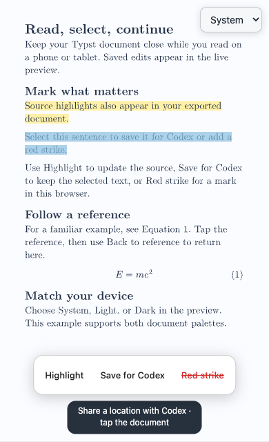

<!-- This file is generated by scripts/link-docs.mjs. Do not edit manually. -->

## Lagrangian user guide

Read and review live Typst documents on your Mac, phone, or tablet. This guide covers everyday reading actions, document setup, installation, and recovery.

## Open your first preview

Use Flow to manage a document’s live preview while editing its Typst source in your usual editor. You need an installed Flow app and a `.typ` entry file. For installation, see **First installation** below.

1. Open `~/Applications/Lagrangian.app`. The Flow menu appears in the menu bar.
2. Click **Add Project** (프로젝트 추가…) and select the document’s `.typ` entry file. The [reading demo](examples/reading-demo.typ) is a small document for trying selection, highlights, references, and themes.
3. Check **Project folder** (프로젝트 폴더). Set it to the workspace root if the entry file uses sibling files or folders outside its own directory.
4. Add any required font or package folders, then click **Save settings** (설정 저장).
5. Click **Start reading** (읽기 시작). Flow saves changed settings, starts the preview if needed, and opens your browser once the engine has a document available. Save a source edit in your editor to see the preview update.

**Result:** Flow runs a preview for this project and opens it in your browser. The same window shows settings validation, the start request, the running engine and document readiness. The browser reports its own rendering progress. If preparation fails, the explanation stays in the window; correct the cause and choose **Read again** (다시 읽기). **Logs** (로그) provides further details. Each project keeps its own entry file, settings, port, and preview lifecycle.

### Project controls and settings

Choose a project from the picker to open or control its preview. **Stop** (중지) disables its service until you use Start again; **Restart** (재시작) restarts it. Closing the project window or quitting the menu bar app leaves started previews running.

**Start reading** also works for an already running project. It waits for an available document before opening the configured address. **Start** starts the service without opening a browser. Switching projects or choosing **Stop** cancels a pending browser opening. Service and settings operations run in the background so the window remains responsive.

Font paths are relative to the project root and separated by semicolons. For example, `fonts;../shared-fonts` selects two folders. The local package folder is optional; use it when your document depends on local packages. Saving changed settings restarts a running preview.

The login checkbox opens the menu bar app after login. Started preview services also resume after login independently of that checkbox. Sleeping or logging out can interrupt availability.

### Resume after an interruption

After a temporary network interruption or engine restart, keep the reading tab open. The paged and HTML readers retain the accepted document and retry the connection. Returning to the tab or reconnecting the network prompts a fresh check. Reading position and zoom stay with the document; an active text selection keeps its displayed content until you explicitly clear it. Source actions still check that the selected revision and source are current.

Flow pauses background status checks while the Mac sleeps and checks again after wake or a network change. Recovery does not open an extra tab or start a project you stopped. On battery, in Low Power Mode or under elevated thermal conditions, Flow checks idle services less often; an explicit reading action remains immediate. Flow respects system sleep and keeps requested previews running independently of the app. Remote reading is available again once the Mac is awake and its network route has recovered.

The app’s **Usage, update and recovery guide** (사용·업데이트·복구 안내) menu opens the bundled PDF. This web guide and that PDF are generated from the same Typst source.

## Read on a phone or tablet

Use remote reading when the preview runs on your Mac and you want to read on another device. The Mac must be awake, the project preview must be running, and the viewing device must have access to the configured Tailscale tailnet and HTTPS route. Tail Hosting supplies that route and its access policy.

1. In Tail Hosting, configure a Tailscale HTTPS route to the project’s local backend, `127.0.0.1:<local-port>`. Match the port shown in Flow’s project settings.
2. In Flow, enter that route’s HTTPS address in **HTTPS address** (HTTPS 주소), then click **Save settings** (설정 저장). Saving restarts a running preview with the allowed origin.
3. Click **Start** if needed, then **Copy address** (주소 복사).
4. On the phone or tablet, connect to the tailnet as required by its access policy and open the copied HTTPS URL in a browser.
5. Confirm that the document renders and that a saved source edit on the Mac appears on the device.

**Result:** The device reads the same live project through its configured HTTPS address. Flow binds the backend to loopback; `http://127.0.0.1:<port>/` refers to the device itself when opened on a phone and cannot reach the Mac. Entering an HTTPS address in Flow does not create a Tailscale route. When you change the local port, update the Tail Hosting route too.

The HTML Reader shows a small notice below the toolbar while saved changes compile, load and appear on screen, including when you have scrolled down. It disappears after the accepted content is displayed. If text selection pauses an update, **Clear selection and update** (선택 해제 후 갱신) releases it explicitly. Open notes, the outline and reading gestures also delay updates until they end. Connection, compilation and loading errors remain visible while the previous document stays readable; mathematics and figures retain their own local composition feedback.

### HTML Reader offline reading and device computation

For a configured HTML Reader, open its Reader HTTPS address. In Reader settings, wait until the offline status confirms that the document is available offline. You may add the page to the phone’s Home Screen using the browser’s share menu. Reopening without the server restores the last complete saved document; an online connection is required to download newer source changes. Browser storage can be removed by the device, in which case reconnect to download the document again.

Supported mathematical decorations and native figure labels adapt to reading width and font size on the viewing device. Reading settings provide a two-position **Device computation load** (이 기기 계산 부하) slider. New viewers start at **Low**: document compilation stays on the server and local math and figure layout remain active. **High** offers the browser’s local compiler as a temporary worker while its page is visible and connected, if the server provides a browser compiler. Swipe, tap or use the keyboard to choose a level. Explicit saved choices survive reloads; previous on/off choices become High/Low. Selecting Low, closing or hiding the page releases its work; the server validates and adopts results for every viewer. Large documents can use substantial memory and battery, so enable this only on a device suitable for the document.

When using Highlight offline, the Reader first stores an explicit request on the device. It has not yet saved the source. After reconnecting, the server checks the original revision and source before saving; changed or uncertain requests require checking the latest document and selecting again. Reader settings show pending and review-needed counts. Repeated delivery of the same request cannot repeat its source edit, and an older result cannot dismiss a newer selection.

## Select and copy text

Select text to copy a passage or use the reading actions. On a touch device, long-press text and adjust the native selection handles; use the device’s Copy action for ordinary copying. The web toolbar near the bottom of the screen offers Copy, Highlight, Save for Codex, and Red strike.

If a selection starts or ends inside a formula, it expands to the complete expression after the selection settles. Formula numbering, attached labels and nearby prose stay outside that expression. **Copy** (복사) writes complete formulas as Typst source including `$...$`, keeps surrounding prose as displayed, and separates copied blocks with one newline. If a formula has no verified source, Copy uses the displayed text and reports that the Typst source could not be confirmed.



**Result:** The selection stays on the rendered revision while you use it. Preview updates wait during an active text selection on desktop and touch devices; dismiss the selection to apply pending edits. On a touch device, wait for the formula selection handles to settle before copying so the whole expression is included.

Dragging or long-pressing does not save a Codex source location. Use **Save for Codex** to save the exact selected text, or dismiss the selection and briefly tap a passage to save a source location. Scrolling alone does not update the saved context.

## Highlight in source

Use a highlight when you want a passage marked in the Typst document itself, including later exports.

1. Select a passage in the preview.
2. Choose **Highlight** (하이라이트) in the bottom toolbar.
3. Wait for the saved-source acknowledgement and compilation. Check the marked passage in the updated preview.

**Result:** This edits the original `.typ` source. The normal source watcher recompiles it, and the highlight appears in exports. To remove a source highlight, edit the source in your editor; the browser’s mark-undo action applies to red strikes.

**Conditions:** Flow must map the full selection to a supported source range, and the candidate document must compile before it is saved. Plain literal text can use the built-in `highlight` function. Complete equations require the source module’s callable `highlighted` helper; see **Document setup** below. Whole inline references can be included with supported text or equation selections. Partial equations or references, reused content, other code or markup, selections spanning source files, and changed source snapshots cannot be edited automatically. If the action is rejected, the selection stays available so you can use Save for Codex instead.

## Save text for Codex

Use this to preserve a passage and its location before asking Codex to explain, review, or edit it.

1. Select the text you want to discuss.
2. Choose **Save for Codex** (Codex 저장) and wait for confirmation that the selected text was saved.
3. In a Codex session with a configured local selection reader, ask a question such as: “Explain the passage I saved from the preview.” Specify the project when you have several previews.

**Result:** Flow saves up to 8000 selected characters and the selection’s page endpoints alongside its source context. This saves context; it does not send a message, start a Codex turn, or compile the document. A newer compiler revision requires selecting again. A brief tap saves a location instead of an exact text selection.

Saved context has no time limit. The local reader still checks the service, document version and source before using its location. For a project registered with both paged and HTML readers, the integrated Tail Hosting reader finds the latest saved text within that same entry document and identifies its reader; a newer tap-only location in another reader does not hide the saved text.

### Connect a local selection reader

Flow writes selection records on the Mac running the preview. Codex needs a local skill or tool that reads the correct project’s record and checks it against the current service and source. Flow does not install that reader automatically. List profile details, including each `focusFile`, with:

```sh
~/Applications/Lagrangian.app/Contents/MacOS/Lagrangian --profiles
```

Configure your reader for the selected project’s `focusFile`, stored under `~/Library/Application Support/Lagrangian/focus/<profile-id>.json`. It should identify the project, check the saved selection’s status and source against the current document, and request a fresh selection if the context is stale. After a service restart, tap or select the passage again before asking about it.

If your project is registered with the existing Tail Hosting focus reader, a local Codex tool or skill can invoke it with the project root:

```sh
/path/to/Tail_hosting/bin/tail-hosting focus --project /absolute/project
```

Replace the paths with your installation and project. This reader is supplied by Tail Hosting and requires its registered profile integration; it is not a command included in the Flow bundle. A Codex session on another computer needs access to this Mac’s record and source before it can use the saved selection. Without a reader, copy the selected passage into your question.

## Add browser review marks

Use a red strike for a reading or review note that should stay outside the source document.

1. Select text and choose **Red strike** (빨간 취소선).
2. Use **Undo** (되돌리기) to remove the latest mark, or **Clear marks** (표시 지우기) to remove this document’s temporary marks in this browser.

**Result:** A red line appears across the selected fragments without source edits or compilation. Marks are stored separately by document in this browser and survive refresh, theme changes, and scrolling through unchanged pages. They are excluded from PDF exports and do not synchronize to other devices.

**Conditions:** A page whose text or layout changes loses its old marks to avoid displaying them over the wrong passage. When browser storage is unavailable, such as in some private sessions, marks stay in memory only and disappear when the view closes.

## Choose a document theme

Use the theme selector to match the reading device or choose a palette for this viewer.

1. Choose **System** (기기 설정) to follow the device’s light or dark appearance, including later changes.
2. Choose **Light** (라이트) or **Dark** (다크) to override that behavior for this viewer. Choose System again to resume device following.

**Result:** Supported documents render with their native light or dark colors. Each viewer chooses independently on the same project port and HTTPS URL. Switching preserves scroll and preview zoom; it waits while a touch text selection is active. The `t` shortcut toggles the native palette.

**Conditions:** The document must read the `theme` input with `"light"` and `"dark"` values; see **Document setup** below. Documents without that contract still preview normally but do not change their native palette. The reading demo supports both themes.

## Return from a reference

Use this when you follow an internal equation, figure, or heading reference and want to resume the passage you were reading.

1. Click or tap the reference.
2. Choose **Back to reference** (참조 위치로 돌아가기) to return to the position immediately before following that link.

**Result:** The preview restores the previous page position, including after preview zoom or window resizing, and the button disappears. Following another reference replaces the return destination with the position before that latest link. This return is for the current document view and clears when the view is replaced, including a theme switch or refresh. It can appear alongside Jump to change.

## Resume the latest visual edit

Use change navigation to return to work after reopening a preview or to inspect a new edit while reading elsewhere.

1. Save an edit that changes rendered output and let the preview render it.
2. Open or refresh the preview to return to its latest successfully rendered visual edit.
3. If a recent reading gesture defers navigation, choose **Jump to change** (변경 위치로) when ready.

**Result:** The project remembers a rendered edit location. Theme switches and reconnecting an already rendered viewer preserve the current reading position. This tracks visual edits, rather than a history of where you scrolled; comments and other edits with no rendered change do not move the saved position.

**Conditions:** While the preview service runs, saves made with all viewers closed retain their latest source location without compiling an idle palette. Light and dark share that source location and map it into their own layouts when opened, including a palette that has not been used before. A current saved location takes priority. If none is usable, Flow can use Git changes against HEAD that map to the document; these are cumulative changes, rather than the order of edits. Without a usable saved, tracked-source, or Git location, the initial view stays at the beginning.

## Understand preview status

The small status ring shows activity while the browser prepares the renderer, connects, waits for the document, compiles, or draws pages. It disappears after rendering. Compiler or rendering failures show a static error; a dropped connection shows reconnection activity. These states describe activity rather than estimated completion percentages.

**Returning from another app:** iOS and iPadOS can suspend a home-screen web app and interrupt its connection. Returning checks the existing connection and reuses it if it responds. A dropped connection retries on return, keeping the document, zoom and reading position visible. A native text selection holds the replacement document until the selection is dismissed. Source updates still render normally. Background suspension or a page reload can still require document transfer; connection recovery does not guarantee continuous background access.

- **Update paused while text is selected:** updates wait until you dismiss the selection; waiting longer does not resume them. Tap **Clear selection and update** in the status notice, or dismiss the selection by tapping an empty area of the document. This paused state has no loading ring, and your selection remains available until you clear it.
- **Long wait or compilation error:** open Logs in Flow and check the document in your editor. A responding HTTP server does not prove successful compilation.
- **Mobile URL does not connect:** confirm that the Mac is awake, the preview is started, the device has tailnet access, and the route points to the current local port. Check the HTTPS address saved in Flow.
- **Theme colors do not change:** confirm the document’s theme input contract below.
- **Highlight is rejected or a saved selection is stale:** wait for rendering and select again. Unsupported source ranges can be saved for Codex instead.
- **macOS requests document access:** complete the native consent prompt on the Mac. Preview activity itself is not proof that a permission prompt is open.

## Document setup

These settings belong to the Typst document. The [reading demo](examples/reading-demo.typ) provides a complete working example.

### Native theme colors

Read the theme input and use it for your page and text colors:

```typ
#let dark = sys.inputs.at("theme", default: "light") == "dark"
#set page(fill: if dark { rgb("172033") } else { white })
#set text(fill: if dark { white } else { black })
```

Managed previews keep independent light and dark variants and compile each while viewers are connected. Viewers of the same palette share a compilation; each viewer downloads only its selected variant. Color-only variants preserve layout most predictably. When both palettes have viewers, compiling both uses additional host memory and CPU. PDE and Ewald already follow this theme contract.

For standalone paged preview, opt in with:

```sh
tinymist preview main.typ --follow-system-theme
```

This overrides an explicit `--input theme=...` while retaining unrelated inputs. Without the flag, preview keeps its existing behavior. HTML and bundle outputs do not support this option.

### Theme-aware source highlighting

Define a callable `highlighted` helper in the module that contains the selected source:

```typ
#let highlighted(body) = highlight(
  fill: if dark { rgb("63521f") } else { rgb("fff0a8") },
  body,
)
```

Flow uses this helper to write `#highlighted[...]` for supported text and complete equations, preserving the document’s theme handling. Without it, literal text uses `#highlight[...]`; equations cannot be highlighted automatically. Rendered glyph coverage verifies complete equations even when their notation differs from source, and an isolated compiler render verifies complete selected inline references, including a scoped `ref` helper’s generated equation number.

A custom helper must accept a single text element or equation as well as mixed content. When iterating its body, use `if body.has("children") { body.children } else { (body,) }` so singleton content does not cause a missing-field error.

### Saved change locations

Each profile stores one private `changes/<profile-id>.json` record in Application Support, independently of explicit assistant selections, with separate light and dark positions. Unchanged source retains its position across service restarts and renderer updates. If source changed while the service was stopped, the first compilation establishes a baseline without guessing a new edit from the first changed page.

The Git fallback considers staged, unstaged, and nonignored new source files used by this document. With multiple candidates it chooses the earliest body page, then the topmost position on that page. It does not infer editing order. Standalone paged preview can opt in by setting `TINYMIST_PREVIEW_CHANGE_FILE` to an absolute path; records are scoped to the project root and entry file. This does not expose a new network endpoint.

## Files and ownership

- App and installed engine: `~/Applications/Lagrangian.app`
- Profiles and explicit selection records: `~/Library/Application Support/Lagrangian/`
- Logs: `~/Library/Logs/Lagrangian/`
- Previous app bundles: Application Support’s `releases/` folder
- LaunchAgents: `~/Library/LaunchAgents/`

Flow manages engine execution, project profiles and preview lifecycle. Tail Hosting owns Tailscale HTTPS routes and remote access policy. Changing a local port requires updating its Tail Hosting route. Original Typst source files stay in their project folders.

## First installation

On a fresh Mac, use macOS 13 or newer with Git, the Swift compiler, Python 3, Node.js, Yarn, and the workspace Rust toolchain from `rust-toolchain.toml`. Build the maintained preview frontend and engine before installing:

```sh
git clone https://github.com/kimpossible-TY/Lagrangian.git
cd Lagrangian
yarn install --immutable
node scripts/build.mjs build:preview
python3 scripts/flow-app.py build --build-engine --jobs 2
python3 scripts/flow-app.py install dist/Lagrangian.app
```

Open the installed app and follow **Open your first preview**. If macOS requests access to the document’s folder, complete that prompt on the Mac.

If you already have a compatible `flow-engine` from a Flow bundle, package it without rebuilding Rust or the frontend:

```sh
python3 scripts/flow-app.py build --engine /absolute/path/to/flow-engine
python3 scripts/flow-app.py install dist/Lagrangian.app
```

External engine selection uses `--engine`, then `FLOW_ENGINE_PATH`, then the engine in the current `Lagrangian.app` or former `tinymist-flow.app` installation. A fresh machine without such an engine needs the native build above. The build checks required preview CLI support and copies the engine into the new app. AppKit and Foundation are the app runtime dependencies; packaging uses the Swift compiler and Python 3. The installed engine stays independent of build output.

The native engine build uses the `flow-release` profile with ThinLTO. Its target, profile, Rust flags and any LTO override are recorded in `engineBuild` alongside the engine version and hashes. Use a native ARM Python environment on Apple Silicon. The build copies its result into the staged app and preserves an existing output bundle if packaging fails.

Managed previews compile the light and dark variants when viewers connect to them. Source updates are retained while a variant has no viewers; reconnecting requests its current document. Multiple viewers of the same palette share one compilation. The host classifies interactive CPU work and cache maintenance separately for macOS scheduling.

The app keeps the upstream engine protocol and VS Code configuration names. For the installed engine, set `tinymist.serverPath` to the absolute path ending in `Lagrangian.app/Contents/MacOS/flow-engine`. Remote VS Code settings must refer to the remote host’s installed path.

## Signing and macOS consent

The app bundle ID is `io.github.kimpossible-ty.lagrangian`. Configure a persistent code-signing identity or set `FLOW_SIGN_IDENTITY`. Without either, the build is signed ad hoc. Because macOS treats the renamed app as a new identity, it may request Documents access again; approve that request in macOS when prompted. The app name and icon identify the request, but do not replace OS consent. Administrator authentication must be completed by the user when macOS requires it.

For repeated personal builds, create one code-signing certificate using Keychain Access’s Certificate Assistant or use an existing Apple signing identity. Retain the certificate and its private key in Keychain, then save its identity once:

```sh
python3 scripts/flow-app.py configure-signing --identity "Lagrangian Local Signing"
python3 scripts/flow-app.py build --version 0.1.9
```

The first signing probe may ask for Keychain access. Complete authentication locally and select Always Allow for `/usr/bin/codesign` to reuse this key. Configuration is saved only after the probe succeeds; cancelling leaves the previous configuration intact.

The saved configuration is `~/Library/Application Support/Lagrangian/signing.json`; it contains the public certificate identifier, not a private key or password. The first Lagrangian launch migrates the former `tinymist-flow` support and log directories and leaves symlinks at the old locations for existing services. Builds choose `--identity`, then `FLOW_SIGN_IDENTITY`, then the saved identity. A missing configured identity stops the build instead of falling back to ad-hoc signing. Both the app and bundled engine use the same certificate; the release manifest records its SHA-256 fingerprint, which bundle verification checks for both signatures. A personal self-signed certificate establishes a local identity; it does not provide Apple notarization or public distribution approval.

The initial switch from ad-hoc signing may require one new Documents approval. Keep the same certificate for later builds. Verify document delivery after a subsequent installed build before treating permission continuity as confirmed. Certificate replacement or loss may require consent again.

## Update and recover

When moving from `tinymist-flow.app`, install `Lagrangian.app` alongside it. The installer does not delete the former app or stop its services. On first launch, Lagrangian moves the old Application Support and Logs directories to the new names and leaves compatibility symlinks so existing services can continue using their recorded paths. Do not remove the old app until you have opened Lagrangian, verified your profiles and previews, and disabled or updated its legacy login item. To transfer a running preview to Lagrangian, use its Restart control; this preserves the existing profile and LaunchAgent label while updating the executable path. macOS may request document access again because the bundle identifier changed.

The former bundle remains available at `~/Applications/tinymist-flow.app` until you remove it yourself. After the first Lagrangian installation, subsequent updates use the recovery-aware replacement flow below:

```sh
python3 scripts/flow-app.py build
python3 scripts/flow-app.py install dist/Lagrangian.app
```

This reuses the installed engine and its preview features. For engine or preview changes, rebuild the frontend with `node scripts/build.mjs build:preview` and pass `--build-engine --jobs 2` to the build. For a confirmed release, use a short feature branch, run the relevant tests, merge into `main`, and build from a clean commit with an explicit `--version`.

The installer checks the bundle signature, engine hash and version before replacing anything, waits for managed profiles to stop, backs up the prior Lagrangian app, restarts those profiles, and checks HTTP startup. If startup fails, it restores the previous Lagrangian bundle. Verify document rendering after installation; HTTP alone does not establish document health.

An ad-hoc update can wait for macOS Documents consent before opening its HTTP listener. To allow time for that prompt, defer live health verification during the single installation:

```sh
python3 scripts/flow-app.py install dist/Lagrangian.app --defer-health-check
```

This option retains the new bundle while consent is pending. Bundle validation, backups, and recovery from replacement or service-control errors still apply. After completing consent, verify the running profile, its HTTP endpoint, and delivery of the rendered document. The installer reports that this live verification remains pending.

```sh
python3 scripts/flow-app.py verify ~/Applications/Lagrangian.app
python3 scripts/flow-app.py rollback
```

Rollback restores the previous app while preserving profiles and source files. Keep the backup until the new version is confirmed. Release metadata records the Flow source revision, dirty-worktree flag, engine version and input hash, bundled engine hash, app version and signing mode. Tag confirmed installed releases as `flow-vX.Y.Z`; retain one code commit per feature and a separate deployment record.

## Tail Hosting migration

```sh
python3 scripts/flow-app.py migrate-tail-hosting /path/to/Tail_hosting
```

This imports project settings, backs up the old registry and launcher, and installs a small lifecycle adapter. Existing labels and ports remain usable by status and focus readers. Activate the imported profile using Restart in Flow. Inspect macOS consent and verify HTTPS document delivery before considering migration complete.

```sh
python3 scripts/flow-app.py restore-tail-hosting
```

The restore command reinstates the old registry, launcher and preview LaunchAgent from the migration backup. Unrelated hosted services are preserved. The adapter does not create or change Tailscale Serve routes.

## Maintaining the Flow app

Use this repository for the app, engine, preview frontend, branding, packaging, tests, and documentation. Keep app work in `apps/macos`, branding in `assets/branding`, and behavior contracts in OpenSpec. Package a compatible external engine or build the maintained engine sources. Both paths supply mobile selection, assistant focus, device themes, change restoration, selected text actions, and preview activity status. Small local fixes can stay lightweight. Preserve upstream copyright, Apache License 2.0, and applicable third-party notices.

Test a replacement engine for compatibility before bundling it, and keep its version and hash alongside the Lagrangian source revision. App work does not require rebuilding or maintaining the language server. The private production repository is `kimpossible-TY/Lagrangian`. Engine and preview implementations are maintained in this tree; Tinymist crate, CLI and protocol identifiers remain unchanged.
